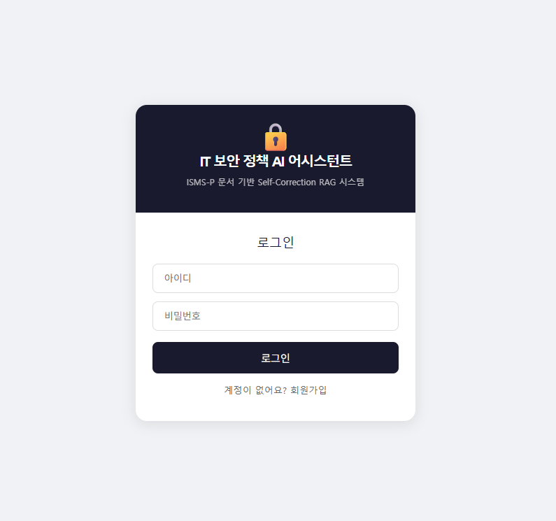
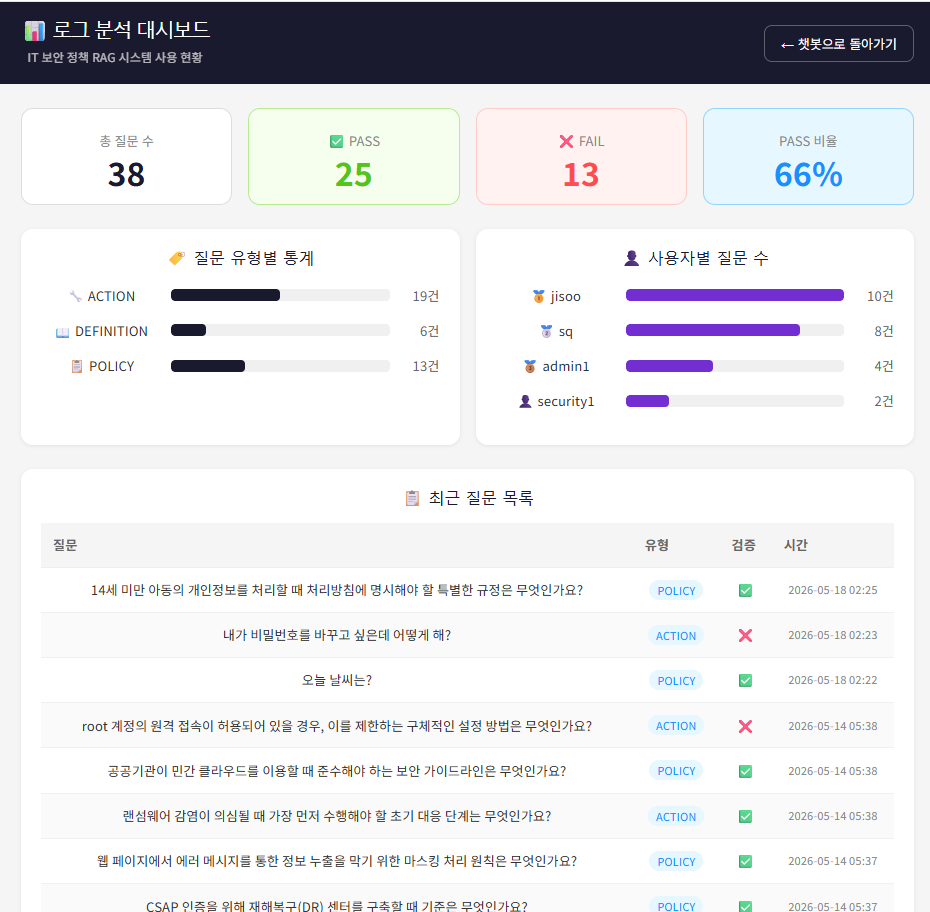
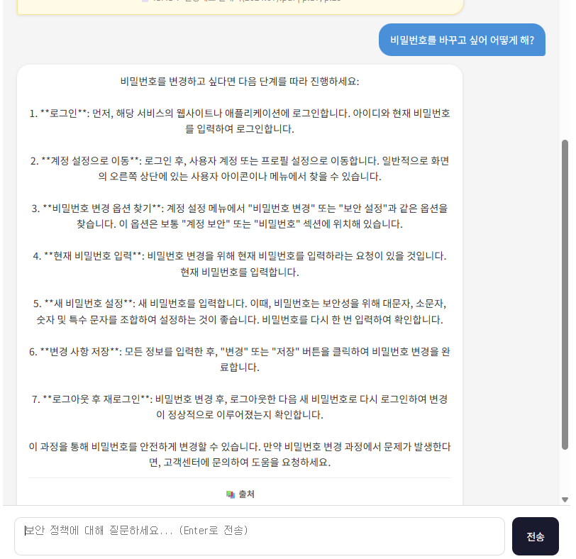
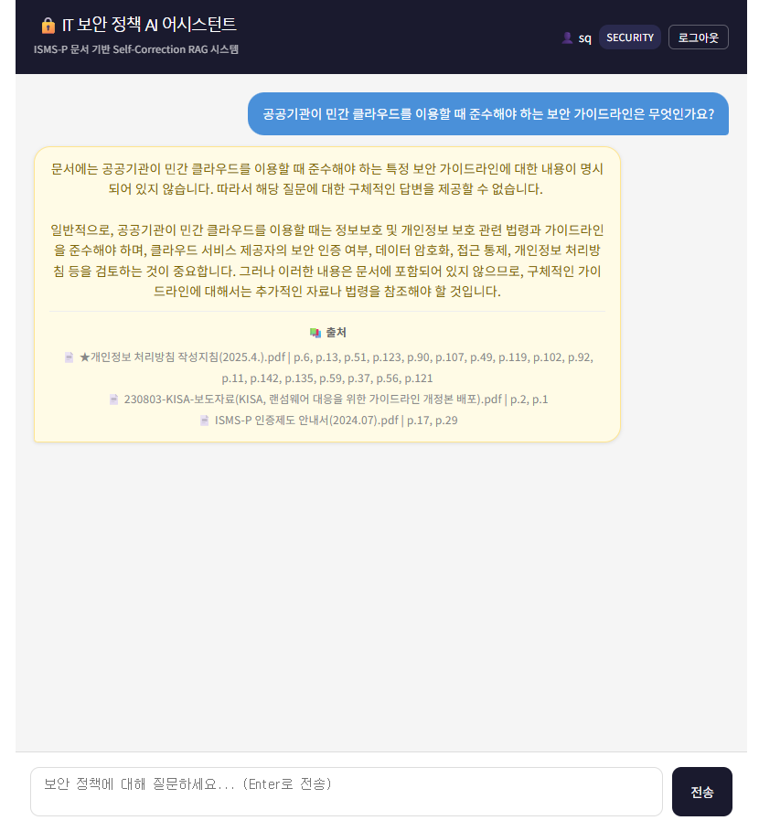
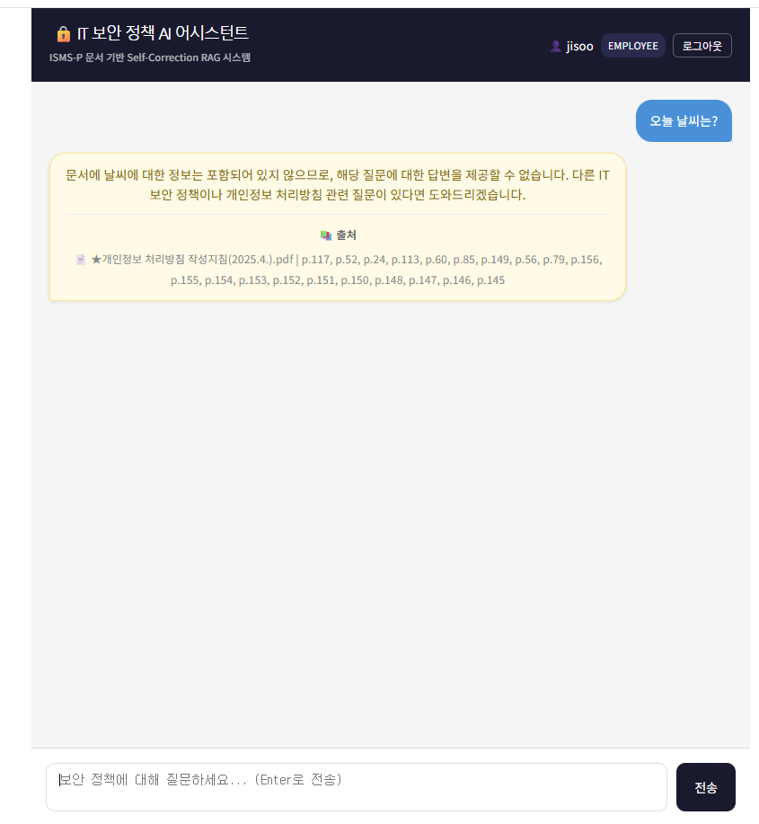
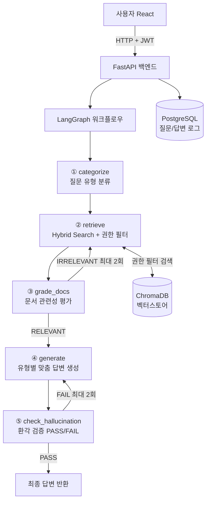

> 로컬/운영 환경변수 분리, Chroma 재시작 복구, 무료 배포 후보 및 npm 취약점 판단은 [배포 가이드](DEPLOYMENT.md)를 참고하세요. docker-compose.yml은 로컬 개발용입니다.

<div align="center">

# 🔐 기업 IT 보안 정책 AI 어시스턴트
### ISMS-P 문서 기반 Self-Correction RAG 시스템

**"단순히 RAG를 만든 것이 아니라, 답변의 환각(Hallucination)을 줄이기 위해 이중 검증 루프를 설계했습니다."**

[](https://fastapi.tiangolo.com)
[](https://langchain-ai.github.io/langgraph/)
[](https://www.trychroma.com)
[](https://react.dev)
[](https://www.postgresql.org)
[](https://aws.amazon.com)
[](https://www.docker.com)

### 🌐 [AWS EC2 배포 환경에서 실제 서비스 체험하기 →](http://3.26.94.252/)

</div>

---

## 📸 서비스 화면

<table>
  <tr>
    <td align="center" width="50%">
      
      <br/><sub><b>JWT 기반 로그인</b></sub>
    </td>
    <td align="center" width="50%">
      
      <br/><sub><b>ADMIN 전용 로그 분석 대시보드</b></sub>
    </td>
  </tr>
  <tr>
    <td align="center" width="50%">
      
      <br/><sub><b>ACTION 유형 — 단계별 절차 답변</b></sub>
    </td>
    <td align="center" width="50%">
      
      <br/><sub><b>SECURITY 권한 — 다중 문서 출처 표시</b></sub>
    </td>
  </tr>
  <tr>
    <td align="center" width="50%">
      
      <br/><sub><b>범위 외 질문 — 출처 없으면 답변 거부</b></sub>
    </td>
    <td align="center"></td>
  </tr>
</table>


---

## 🎯 핵심 차별화 포인트

| | 일반 RAG | **이 프로젝트** |
|---|---|---|
| **검색 방식** | 벡터 검색만 사용 | 벡터 + BM25 **Hybrid Search** |
| **검색 품질** | 결과 그대로 사용 | 문서 관련성 LLM 평가 후 **재검색** (최대 2회) |
| **답변 생성** | 1회 생성 후 반환 | 환각 검증(PASS/FAIL) 후 **자동 재생성** (최대 2회) |
| **출처 처리** | 출처 표시만 | 출처 없으면 **답변 자체 차단** |
| **접근 제어** | 없음 | **EMPLOYEE / SECURITY / ADMIN** 3단계 권한별 문서 분리 |
| **운영 관리** | 없음 | ADMIN 전용 **로그 분석 대시보드** |

---

## 🏗️ 시스템 아키텍처



---

## ⚙️ 기술 스택

| 기술 | 선택 이유 |
|------|-----------|
| **LangGraph** | 검증 → 재시도 순환 루프를 그래프 구조로 명확하게 표현 |
| **ChromaDB + BM25** | 의미 검색(벡터) + 정확 검색(키워드) 병행으로 검색 누락 최소화 |
| **text-embedding-3-small** | 비용 효율적이면서 한국어 문서 처리 성능 검증 |
| **FastAPI** | 비동기 처리 + 자동 Swagger 문서 + Pydantic 타입 안전성 |
| **PostgreSQL** | 정형 로그 저장 및 대시보드 집계 쿼리 최적화 |
| **JWT (HS256)** | Stateless 토큰으로 권한(role) 정보 내장, 서버 세션 불필요 |
| **AWS EC2 + Docker** | 로컬-서버 환경 차이 제거(컨테이너화) + 클라우드 배포 일관성 |

---

## 🔑 핵심 구현 — Hybrid Search + Query Rewriting

일반 RAG와 가장 차별화되는 부분입니다. 벡터 검색과 BM25 키워드 검색을 병행하고, 권한 필터를 적용한 뒤 중복을 제거합니다. 재검색 시에는 LLM이 질문을 키워드 중심으로 자동 재작성(Query Rewriting)하여 검색 다양성을 확보합니다.

```python
# 권한 레벨에 따라 접근 가능한 문서 필터 동적 생성
accessible = [r for r, l in ROLE_LEVELS.items() if l <= user_level]
filter_dict = {"$or": [{"permission": p} for p in accessible]}

# 벡터 검색 + BM25 병행 후 중복 제거
vector_docs = vectorstore.similarity_search(question, k=k, filter=filter_dict)
bm25_docs   = bm25_retriever.invoke(question)

seen, combined = set(), []
for doc in vector_docs + bm25_docs:
    if doc.page_content not in seen:
        seen.add(doc.page_content)
        combined.append(doc)

# 재검색 시 질문 자동 재작성 + 검색 범위 확장 (k: 4 → 8 → 12)
if state["retrieve_count"] > 0:
    question = llm.invoke(rewrite_prompt).content.strip()
    k += 4
```

---

## 🔥 결과 및 Trouble Shooting

### TS #1 · AWS EC2 디스크 용량 고갈 — 서버 다운 및 컨테이너 응답 불가

> **문제**: AWS EC2 인스턴스 배포 후, 첫 질문 요청 시 컨테이너가 응답 없이 종료되거나 먹통이 되는 현상 반복 발생. 로그 확인 시 `Killed` 또는 파일 쓰기 실패 메시지 감지.
>  
> **원인**: 초기 EC2 인스턴스의 기본 EBS 볼륨 크기(8GB)가 RAG 시스템의 대용량 데이터를 감당하기에 부족했음. Docker 이미지 패키지, ChromaDB의 Vectorstore 데이터, KISA PDF 원본 문서가 누적되면서 **디스크 저장 공간 고갈(No space left on device)** 발생.
>  
> **해결**: AWS 콘솔에서 **EBS 볼륨 크기를 증설**한 후 내부 파일 시스템 확장을 수행하였으며, `docker system prune`을 통해 불필요한 레이어 캐시를 정리하여 가용 저장 공간을 확보함.
>  
> **학습**: RAG 서비스 특성상 임베딩 데이터 및 소스 문서로 인해 디스크 사용량이 급증할 수 있으므로, 배포 환경 구축 시 초기 디스크 볼륨 산정과 주기적인 Docker 리소스 청소가 필수적임을 배움.

---

### TS #2 · 대시보드 사용자 통계 미표시 — username NULL 저장

> **문제**: ADMIN 대시보드 "사용자별 질문 수"에 데이터 없음  
> **원인**: 로그인 기능 추가 후 `save_log()` 호출부에 `username` 인자 누락 → 전체 행 NULL 저장 → `GROUP BY username` 집계 불가

```python
# 수정 전 — username 누락
save_log(question, answer, sources, question_type, is_valid, ...)

# 수정 후 — username 추가
save_log(..., username=current_user["username"])
```

> **학습**: 기능을 순차적으로 추가할 때 기존 연동 지점(함수 호출부)을 함께 업데이트해야 함

---

## 📁 프로젝트 구조

```
security-rag/
├── backend/
│   ├── rag_chain.py   # LangGraph 핵심 — 분류→검색→생성→검증→재시도
│   ├── main.py        # FastAPI 서버 — 엔드포인트, CORS, 로그 저장
│   ├── ingest.py      # PDF 전처리 — 청킹(chunk 500/overlap 50), 임베딩
│   ├── auth.py        # JWT 생성·검증, bcrypt 해시
│   ├── database.py    # PostgreSQL 연결, 로그 저장, 대시보드 쿼리
│   ├── data/          # KISA 보안 문서 PDF 원본
│   └── vectorstore/   # ChromaDB 영구 저장
├── frontend/src/      # React — 챗봇 UI, 로그인, ADMIN 대시보드
├── docker-compose.yml
└── .env               # API 키, JWT 시크릿, DB 정보 (Git 제외)
```

---

## 🚀 실행 방법

**Docker (권장)**
루트 `.env`에 `OPENAI_API_KEY`, `DB_HOST`, `DB_PORT`, `DB_USER`,
`DB_PASSWORD`, `DB_NAME`, `SECRET_KEY`를 설정합니다. `.env.example`을
참고하고, 실제 `.env`는 Git에 추가하지 않습니다.

Docker에서는 백엔드의 DB 주소를 Compose가 `db:5432`로 지정합니다.
로컬 실행용 `.env`의 `DB_HOST=localhost`를 그대로 두어도 됩니다.

```bash
docker compose up -d db
docker compose run --rm backend python ingest.py  # 최초 1회, OpenAI API 사용
docker compose up -d --build
# → http://localhost
```

**Windows 로컬 실행 (PowerShell)**

Python 3.11(Docker 기준) 또는 3.12, Node.js 22.13 이상인 22.x 또는
24.x, npm, PostgreSQL 15를 준비합니다. PostgreSQL에 `.env`의
`DB_NAME`과 일치하는 데이터베이스 및 접속 계정을 먼저 생성해야 합니다.
서버 시작 시 `users`, `chat_logs` 테이블이 생성되며, 기존 `chat_logs`에
`username` 컬럼이 없으면 추가됩니다. 과거 로그의 사용자명은 복원되지 않습니다.

프로젝트 루트에서:

```powershell
py -3.12 -m venv venv
.\venv\Scripts\python.exe -m pip install -r backend/requirements.txt
.\venv\Scripts\python.exe backend/setup_ocr.py # 한국어/영어 OCR 언어 데이터 최초 설치
$env:DB_HOST = 'localhost' # 이 프로세스에서만 적용, .env 파일은 변경하지 않음
.\venv\Scripts\python.exe backend/ingest.py # 최초 1회, OpenAI API 사용
.\venv\Scripts\python.exe -m uvicorn main:app --app-dir backend --host 127.0.0.1 --port 8001
```

별도 터미널에서 프론트엔드 폴더로 이동한 뒤:

```powershell
npm.cmd ci
npm.cmd run dev -- --port 5173 --strictPort
```

화면: http://localhost:5173 / API 문서: http://localhost:8001/docs

새 DB에서는 회원가입 후 로그인합니다. 계정은 자동 생성되지 않습니다. 관리자 대시보드는 `ADMIN` 계정이 필요합니다.

**가입·관리자·로그 권한**

일반 `/register` 요청은 `role`을 보내도 항상 `EMPLOYEE`로 생성됩니다.
최초 관리자는 운영자가 로컬 콘솔에서 기존 가입 계정에 한해 지정합니다.
관리자가 이미 있으면 이 명령은 거부됩니다.

```powershell
.\venv\Scripts\python.exe backend/bootstrap_admin.py <가입한_아이디>
```

그 이후 역할 변경은 관리자 토큰으로
`PATCH /admin/users/{username}/role`에
`{"role":"EMPLOYEE"}`, `{"role":"SECURITY"}` 또는 `{"role":"ADMIN"}`을 보냅니다.
일반 사용자는 호출할 수 없고 관리자는 자신의 관리자 권한을 해제할 수 없습니다.
`/logs`는 EMPLOYEE/SECURITY에게 본인 로그만, ADMIN에게 전체 로그를 반환합니다.
관리자 대시보드는 ADMIN만 접근할 수 있습니다.

**운영 환경 설정**

`SECRET_KEY` 기본값은 없으며 누락·빈 값이면 서버 시작을 거부합니다.
기존 공개 코드의 기본 시크릿을 사용했다면 별도의 강한 무작위 값으로 직접 교체해야 합니다.
`APP_ENV=production`에서는 `CORS_ORIGINS`를 쉼표로 구분한 HTTPS origin으로
반드시 지정합니다(예: `https://app.example.com`). 경로·와일드카드는 허용하지 않습니다.
로컬 기본 CORS는 localhost의 5173/80만 허용합니다.

프론트엔드 개발 실행은 `VITE_API_URL`이 없으면 `http://localhost:8001`을 사용합니다.
운영 빌드는 `VITE_API_URL`을 반드시 지정하며 외부 API 주소는 HTTPS여야 합니다.
프론트엔드 폴더의 `.env` 또는 빌드 프로세스 환경변수로 지정합니다.
루트 `.env`의 값은 Docker Compose에서 빌드 인자로 전달합니다.

```powershell
$env:VITE_API_URL = 'https://api.example.com'
npm.cmd run build
```

로컬 API 포트는 8001로 통일합니다. 이전 사용자/샌드박스 계정이 시작한 서버가
점유하면 해당 소유자 또는 관리자가 종료한 뒤 같은 Windows 사용자로 다시 시작합니다.
포트가 열려 있다는 사실만으로 외부 API 통신까지 가능한 것은 아닙니다.

보안 설정/권한 회귀 테스트:

```powershell
$env:RUN_DB_TESTS = '1'
.\venv\Scripts\python.exe -m unittest discover -s backend -p test_security.py -v
```

PDF 임베딩이 완료되지 않은 상태에서는 질문 검색이 정상 작동하지 않습니다.
Windows에서 PyMuPDF 1.27.2.3 DLL이 차단되던 문제는 1.28.2 업데이트로
해결했습니다. requirements.txt에 지정된 버전을 사용합니다.

**이미지/스캔 PDF의 OCR fallback**

PyMuPDF의 기본 텍스트 추출을 먼저 수행하고, 공백을 제외한 텍스트가
40자 미만이며 이미지 또는 도형이 있는 페이지만 300 DPI, `kor+eng`로
OCR 처리합니다. 빈 페이지와 짧은 텍스트만 있는 페이지는 OCR하지 않습니다.
OCR 결과가 기존 텍스트보다 짧으면 기존 텍스트를 유지합니다.

현재 PyMuPDF wheel에 포함된 OCR 엔진을 사용하므로 별도 Python OCR
패키지나 Windows Tesseract 실행 파일은 필요하지 않습니다. `setup_ocr.py`는
공식 `tesseract-ocr/tessdata_fast` 4.1.0의 한국어·영어 모델을 SHA-256으로
검증한 뒤 `backend/.tessdata`에 설치합니다. 이 폴더는 Git에서 제외합니다.
다른 언어 데이터 위치를 사용하려면 `TESSDATA_PREFIX`로 지정할 수 있습니다.
Docker 이미지는 빌드 시 같은 설치 스크립트를 실행합니다.

OCR 결과도 기존 500자/50자 겹침 분할과 동일한 임베딩 모델을 사용하며,
출처 파일명·원본 페이지 번호·권한 메타데이터를 유지합니다. 재수집 시
동일 청크는 다시 추가하지 않고, 변경된 청크가 모두 저장된 뒤 해당 문서의
오래된 청크를 정리합니다. 전체 PDF 수집이 끝난 뒤 백엔드를 재시작하세요.

OCR/저장 회귀 테스트:

```powershell
.\venv\Scripts\python.exe -m unittest discover -s backend -p test_ingest.py -v
```

DB 회귀 테스트(테스트 전용 임시 스키마를 생성하고 종료 시 삭제):

```powershell
$env:RUN_DB_TESTS = '1'
.\venv\Scripts\python.exe -m unittest discover -s backend -p test_database.py -v
```

---

<div align="center">


</div>
